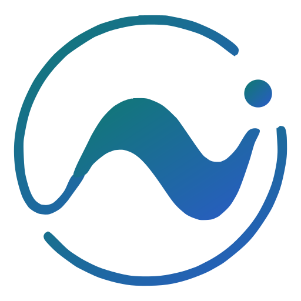
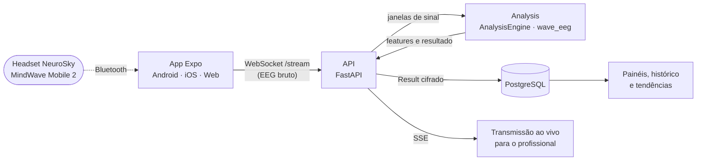

<p align="center">
  
</p>

<h1 align="center">WaveAI</h1>

<p align="center"><strong>Meça o que o questionário só consegue perguntar.</strong><br>
EEG de consumo, análise e tendências para bem-estar e autoconhecimento.</p>

<p align="center">
  <a href="https://github.com/WaveAI-Company/WaveAi-Company/actions/workflows/ci.yml"></a>
  <a href="https://waveai.tec.br"></a>
  
</p>

---

## O que é

O WaveAI capta e analisa sinais de **EEG de consumo** (headset **NeuroSky MindWave Mobile 2**, canal único em FP1, 512 Hz) para **bem-estar e autoconhecimento**. A plataforma tem dois papéis: a **pessoa** que faz as sessões (paciente) e o **profissional de bem-estar** que a acompanha, com a permissão dela.

**A tese: medir, em vez de só perguntar.** Acompanhar como alguém se sente costuma depender de questionários e de memória. O WaveAI acrescenta uma segunda fonte: o sinal do próprio cérebro, sessão após sessão, mostrado como **estados mentais, composição por banda e tendências ao longo do tempo**. A IA organiza as análises e os insights; **quem arbitra é o profissional** (e a própria pessoa).

> Uso **exploratório** de bem-estar. O WaveAI **não é clínico, não é diagnóstico** e não substitui avaliação profissional (ver o aviso ao final).

## Como funciona



Toda a análise fica atrás da interface `AnalysisEngine` (hoje, o pacote `wave_eeg`), e cada resultado grava a `engine_version` que o produziu. Detalhes em [`Architecture/22_MVP_Platform_Architecture.md`](Architecture/22_MVP_Platform_Architecture.md).

## Recursos

- **Sessão guiada** com olhos abertos e fechados e o **contraste** entre as duas condições.
- **Composição por banda** do espectro e **qualidade do sinal** em cada sessão.
- **eSense** (métricas da NeuroSky) exibido com rótulo de **proprietário e não validado**: complemento, nunca fundamento.
- **Histórico e tendências** por pessoa, com anotações de sessão.
- **Transmissão ao vivo** para o profissional, controlada pela **chave do titular**: a pessoa liga e desliga o compartilhamento.
- **Consentimento e direitos LGPD**: exportar os próprios dados e excluir a conta.
- **Captação em segundo plano** no Android, por serviço em primeiro plano.
- Resultados **cifrados** em repouso no banco.

## Em produção

| O quê | Endereço |
|---|---|
| Web | <https://waveai.tec.br> |
| API | <https://api.waveai.tec.br> |
| Política de Privacidade | <https://waveai.tec.br/documentos/privacidade> |
| Termos de Uso | <https://waveai.tec.br/documentos/termos> |

## Estrutura do monorepo

| Caminho | Conteúdo |
|---|---|
| [`apps/wave-app`](apps/wave-app/README.md) | App Expo (React Native + Web), UI por papel |
| [`services/api`](services/api/README.md) | API FastAPI: auth, domínio, gateway WebSocket, SSE |
| [`services/analysis`](services/analysis/README.md) | Serviço que expõe o `AnalysisEngine` por HTTP |
| [`packages/wave-eeg`](packages/wave-eeg/README.md) | Motor de análise (DSP e features) |
| [`packages/wave-corpus`](packages/wave-corpus/README.md) | Corpus de pesquisa, separado da produção |
| [`infra`](infra/README.md) | Stack local (`docker compose`), provisionamento e deploy |
| [`Fundacao`](Fundacao/README.md) | Documentos fundacionais: visão, objetivos, glossário, roadmap |
| [`Architecture`](Architecture/22_MVP_Platform_Architecture.md) | Arquitetura da plataforma |
| [`DataScience`](DataScience/) | Estratégia de sinal e experimentos |
| [`Medical`](Medical/71_Intended_Use_and_Regulatory_Positioning.md) | Uso pretendido e posicionamento regulatório |
| [`Design`](Design/logos_icones/README.md) | Sistema visual "Maré" e a marca |
| [`Documentation`](Documentation/00_Documentation_Index.md) | Índice e demais documentos do projeto |

## Rodar localmente

Stack de back-end (Postgres, API e Analysis). Veja o [`infra/README.md`](infra/README.md) para as variáveis do `.env`:

```bash
cd infra
cp .env.example .env
docker compose up --build
```

App web:

```bash
cd apps/wave-app
npm install
cp .env.example .env   # EXPO_PUBLIC_API_URL aponta para a API
npm run web
```

A captação com o headset exige o app Android (no iOS ela está implementada, mas ainda não foi validada num aparelho); a web mostra um aviso.

## Documentação

- [`05_Decisions.md`](05_Decisions.md): registro de decisões (ADRs), a fonte de verdade.
- [`MASTER_PLAN.md`](MASTER_PLAN.md): guia mestre do projeto.
- [`Documentation/00_Documentation_Index.md`](Documentation/00_Documentation_Index.md): mapa de toda a documentação.
- [`Fundacao/`](Fundacao/README.md): visão, objetivos e glossário.

## Equipe

- Tiago Bryan Ramos de Oliveira
- Gustavo Mendes Ventieri Mariano
- Nickolas Maia de Araujo

---

<sub>**Aviso.** O WaveAI é de uso exploratório de bem-estar e autoconhecimento. É **não-clínico e não-diagnóstico** e não substitui avaliação profissional.</sub>
